<div align="center">

# NISAR Hazard Watch

**See how Earth changes, through clouds, smoke and darkness.**

NASA-ISRO NISAR radar on an interactive 3D globe: burn scars, floods, forest loss and earthquake
ground motion, from real satellite passes to maps anyone can read.

[](https://github.com/cris-eci/nisar-hazard-watch/actions/workflows/ci.yml)
[](https://nisar-hazard-watch.vercel.app)


**[Live demo](https://nisar-hazard-watch.vercel.app)** ·
**[Method & validation](https://nisar-hazard-watch.vercel.app/method)** ·
**[API contract](docs/analysis-api.md)**

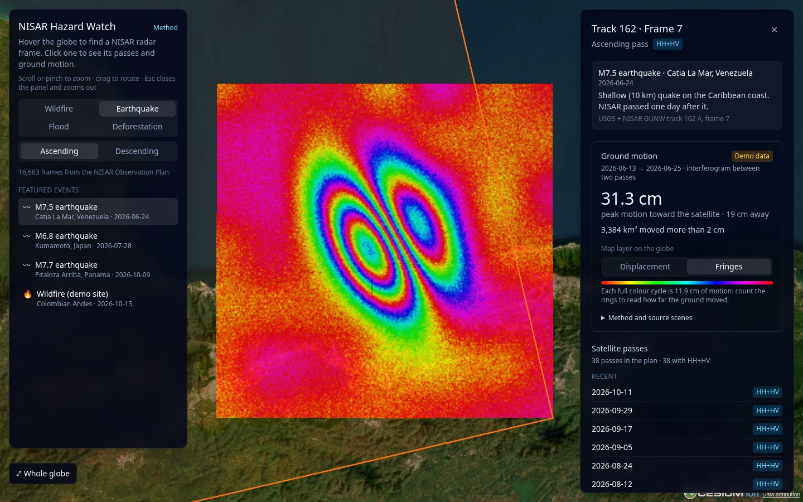

</div>

> [!IMPORTANT]
> **Prototype status.** Everything that says _where_ and _when_ is real NASA, ASF and USGS data.
> The analysis results (burn maps, flood extents, ground motion, validation figures) are
> **simulated demo data**, labelled **Demo data** in the app, until the
> [NISAC_Data_Lab](#architecture) pipeline is connected. See [What is real and what is demo](#what-is-real-and-what-is-demo).

## Contents

- [Why radar](#why-radar)
- [Features](#features)
- [Screenshots](#screenshots)
- [What is real and what is demo](#what-is-real-and-what-is-demo)
- [Featured events](#featured-events)
- [Architecture](#architecture)
- [Getting started](#getting-started)
- [Configuration](#configuration)
- [Testing](#testing)
- [Project structure](#project-structure)
- [Contributing](#contributing)
- [Roadmap](#roadmap)
- [Data sources and credits](#data-sources-and-credits)

## Why radar

|                                   |                                                                                                           |
| --------------------------------- | --------------------------------------------------------------------------------------------------------- |
| **Sees through clouds and smoke** | Optical satellites go blind over an active fire or a tropical storm. Radar brings its own signal.         |
| **Every 12 days, day and night**  | NISAR maps almost all of Earth's land on a fixed cycle, so every change has a clean before and after.     |
| **Down to the centimetre**        | L-band (24 cm) reaches through forest canopy, and comparing two passes measures how far the ground moved. |

## Features

- **3D globe of all 16,663 NISAR frames.** Hover to find a frame, click to fly to it. Frames come
  from NASA's NISAR Observation Plan and are hit-tested locally, so hovering is instant.
- **Two families of analysis behind one contract**
  - _Surface change_ (GCOV backscatter): wildfire burn severity, flood extent, forest loss, in
    hectares, with severity classes and before/after radar images draped on the terrain.
  - _Ground motion_ (GUNW interferograms): earthquake line-of-sight displacement in centimetres,
    with displacement and interferometric fringe layers.
- **Featured events** with real NISAR before/after pairs: three 2026 earthquakes and a fire site.
- **Satellite passes per frame**, live from the Observation Plan, flagging the HH+HV passes that
  burn mapping needs.
- **Shareable views**: `/explore?event=venezuela-2026`, `/explore?frame=47-3`.
- **Guided onboarding**: welcome dialog, _Did you know?_ facts, and a method & validation page.
- **Multi-hazard feature flag**: `VITE_ENABLED_HAZARDS` turns hazards on and off per deployment.

## Screenshots

|                                                                                        |                                                                                |
| :------------------------------------------------------------------------------------: | :----------------------------------------------------------------------------: |
|                     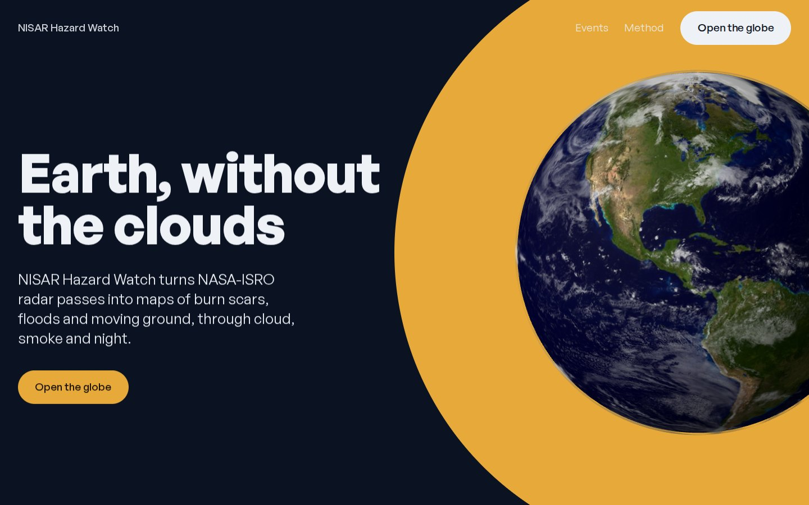                      |         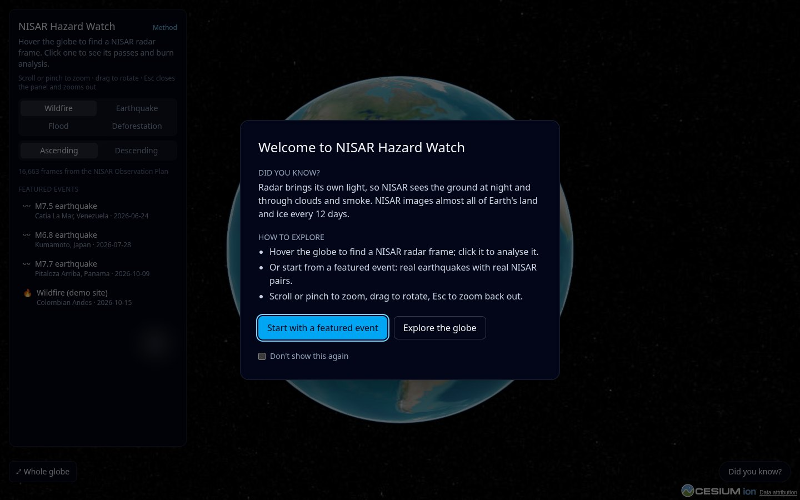         |
|                                    **Landing page**                                    |                           **Welcome and onboarding**                           |
|             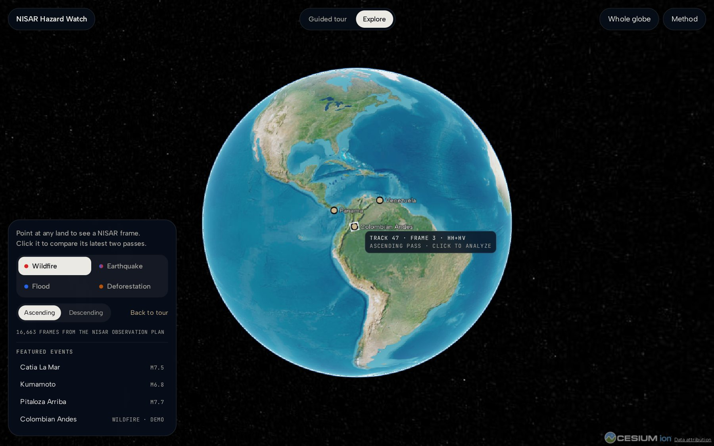             |           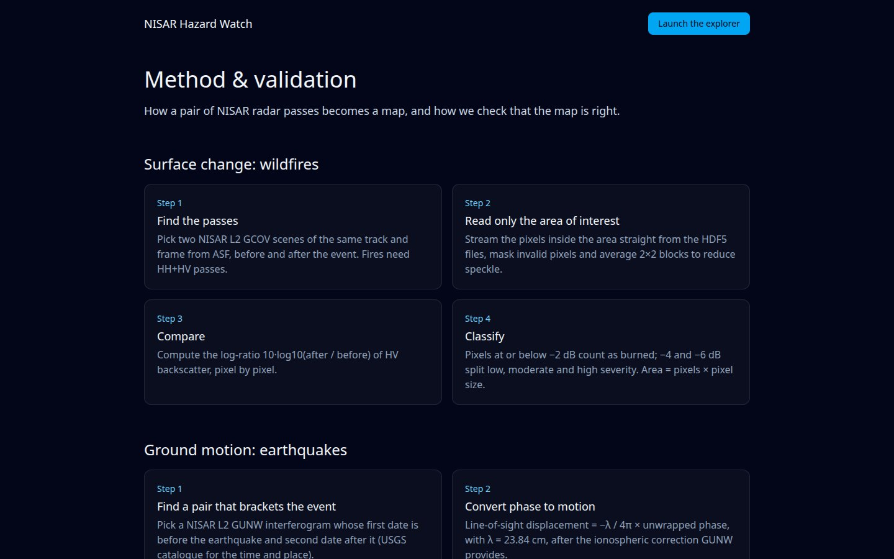           |
|                       **16,663 NISAR frames, hover to inspect**                        |                            **Method & validation**                             |
| 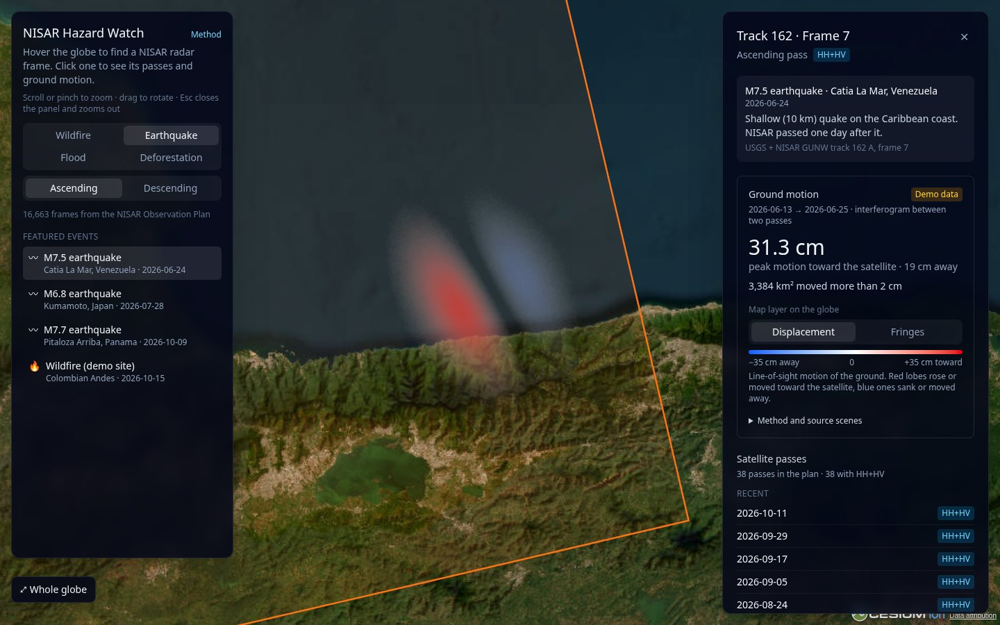 |  |
|                          **Earthquake: displacement (demo)**                           |                         **Earthquake: fringes (demo)**                         |
|           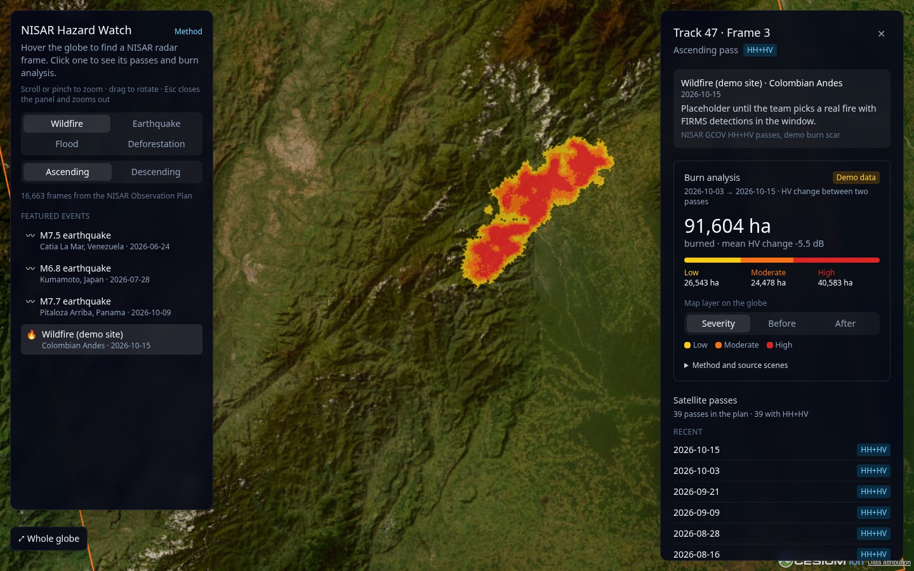            |       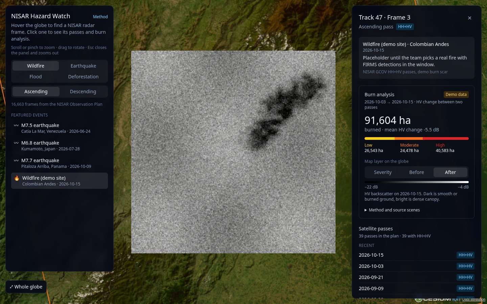        |
|                           **Wildfire: burn severity (demo)**                           |                    **Wildfire: after-fire HV image (demo)**                    |
|                      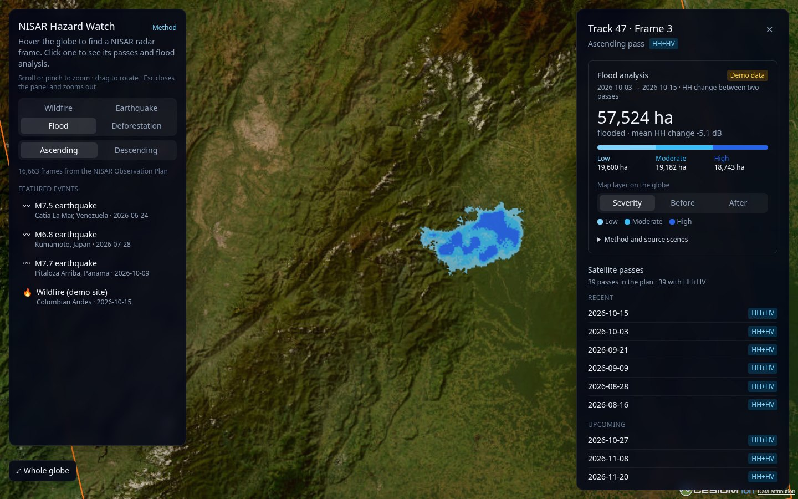                       |               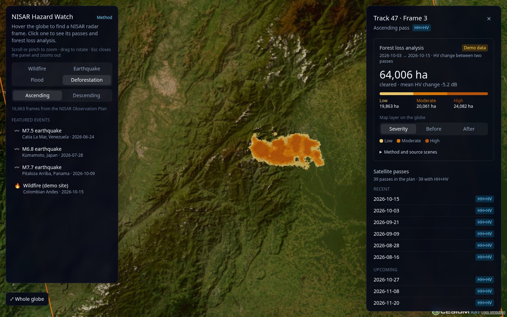               |
|                                **Flood extent (demo)**                                 |                             **Forest loss (demo)**                             |

## What is real and what is demo

### ✅ Real

| Element                                                                    | Source                                                              |
| -------------------------------------------------------------------------- | ------------------------------------------------------------------- |
| 3D globe, navigation, hover, selection, deep links                         | The app itself                                                      |
| The 16,663 NISAR frames (outlines, track, frame, pass, polarization modes) | NASA NISAR Observation Plan (snapshot in `public/data/frames.json`) |
| Satellite passes per frame (past and planned dates, HH+HV or HH only)      | NASA NISAR Observation Plan API, fetched live                       |
| Earthquakes in the featured events (date, magnitude, depth, epicentre)     | USGS earthquake catalogue                                           |
| Before/after interferogram pairs for those earthquakes                     | NISAR L2 GUNW products on ASF DAAC (verified 2026-10-21)            |
| Choice of the passes to compare (latest HH+HV pair for fires)              | App logic over the live pass data                                   |
| Hazard feature flag, pages, onboarding, _Did you know?_ facts              | The app itself (facts from public NISAR mission information)        |
| Client for the analysis API (`VITE_ANALYSIS_API_URL`)                      | Working code; there is no backend to call yet                       |

### 🟡 Demo (simulated, labelled in the app)

| Element                                                  | What it takes to make it real                                                    |
| -------------------------------------------------------- | -------------------------------------------------------------------------------- |
| Burn maps: hectares, severity, before/after radar images | The NISAC_Data_Lab GCOV pipeline behind the [analysis API](docs/analysis-api.md) |
| Earthquake displacement: centimetres, lobes, fringes     | Processing the real GUNW files for the featured pairs                            |
| Flood and forest loss analyses                           | Same pipeline as wildfire, with their own thresholds                             |
| Validation figures on `/method` (87 %, 0.71 κ, 1.8 cm)   | Comparing real results with NASA FIRMS, HLS dNBR and GNSS stations               |
| The wildfire event (Colombian Andes)                     | Choosing a real fire with FIRMS detections inside the NISAR data window          |
| Analysis loading time (~1.5 s)                           | Real time depends on the pipeline                                                |

Demo results are seeded per frame and date pair, so the same view always shows the same result,
and the map always agrees with the numbers next to it.

## Featured events

| Event                                                 | Date       | NISAR pair (before → after) | Frame                |
| ----------------------------------------------------- | ---------- | --------------------------- | -------------------- |
| M7.5 earthquake, Catia La Mar, Venezuela (10 km deep) | 2026-06-24 | 2026-06-13 → 2026-06-25     | Track 162 A, frame 7 |
| M6.8 earthquake, Kumamoto, Japan (8 km deep)          | 2026-07-28 | 2026-07-21 → 2026-08-14     | Track 24 A, frame 18 |
| M7.7 earthquake, Pitaloza Arriba, Panama (13 km deep) | 2026-10-09 | 2026-10-05 → 2026-10-17     | Track 76 A, frame 5  |
| Wildfire, Colombian Andes (demo site)                 | 2026-10-15 | Latest HH+HV pair           | Track 47 A, frame 3  |

Kumamoto and Panama also have descending pairs, which allow separating vertical from horizontal
motion.

## Architecture

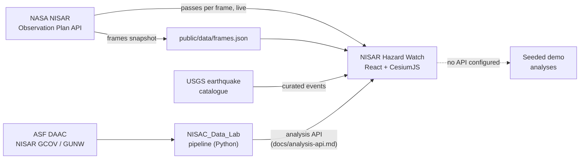

- **Analysis contract:** [`docs/analysis-api.md`](docs/analysis-api.md), mirrored by
  `src/features/analysis/analysis.types.ts`. It maps every field to the pipeline functions.
- **Hazard registry:** `src/features/analysis/hazards.ts`. Each hazard declares its family,
  polarization, colours, copy and demo; the UI never hard-codes a hazard.

## Getting started

Requirements: Node.js 20.19+ and pnpm 8.

```bash
pnpm install
pnpm dev            # http://localhost:5173
```

| Command                              | What it does                                                |
| ------------------------------------ | ----------------------------------------------------------- |
| `pnpm dev`                           | Dev server                                                  |
| `pnpm build` / `pnpm preview`        | Production build and local preview                          |
| `pnpm typecheck`                     | TypeScript, strict                                          |
| `pnpm lint` / `pnpm format`          | oxlint / Prettier                                           |
| `pnpm test`                          | Unit tests (Vitest)                                         |
| `pnpm test:e2e` / `pnpm test:e2e:ui` | End-to-end tests (Playwright), headless or in UI mode       |
| `pnpm frames:fetch`                  | Refresh the NISAR frames snapshot from the Observation Plan |

## Configuration

Copy `.env.example` to `.env.local` to override the defaults in `.env`.

| Variable                | Default                                   | Description                                                                                              |
| ----------------------- | ----------------------------------------- | -------------------------------------------------------------------------------------------------------- |
| `VITE_ENABLED_HAZARDS`  | `wildfire,earthquake,flood,deforestation` | Hazards shown in the app. The picker appears with more than one. Unknown values fall back to `wildfire`. |
| `VITE_ANALYSIS_API_URL` | _(empty)_                                 | Base URL of the analysis service. Empty runs on demo data.                                               |

## Testing

- **Unit (Vitest):** hit-testing, Observation Plan parsing, pair selection, the hazard flag and the
  demo simulations, including regression tests for fixed bugs.
- **End-to-end (Playwright):** Page Object Model, `data-testid` locators and mocked network. Tests
  run against the **production build** with pinned configuration, so local settings cannot change
  the results.
- **CI** runs lint, format, typecheck, unit tests, build and E2E on every push and pull request.

## Project structure

```text
src/
├── pages/            Landing (pages/landing/), Explorer, Method & validation
├── features/
│   ├── analysis/     Contract, hazard registry, API client, demo simulations
│   ├── events/       Featured events (real earthquakes, demo fire)
│   ├── frame-panel/  Frame details, passes, analysis results
│   ├── frames/       Frames snapshot, hit-testing, Observation Plan client
│   ├── globe/        CesiumJS viewer, entities, camera
│   └── onboarding/   Welcome dialog, Did you know
├── content/          NISAR facts
└── lib/              Router, async state, shared UI
docs/                 API contract and screenshots
scripts/              Frames snapshot generator
tests/                Unit (Vitest) and E2E (Playwright, page objects)
```

## Contributing

- **Conventional commits** (`feat:`, `fix:`, `docs:`, …), enforced by commitlint. Husky and
  lint-staged run oxlint and Prettier before each commit.
- **TypeScript strict** with `noUncheckedIndexedAccess`; named exports; `@/` imports; comments say
  _why_, not _what_.
- Every async view handles loading, error (with retry) and empty states.
- Project conventions for people and AI agents: [`CLAUDE.md`](CLAUDE.md).

## Roadmap

- [x] Globe with all NISAR frames and live passes
- [x] Multi-hazard analysis contract (surface change + ground motion) and feature flag
- [x] Featured events with real coseismic NISAR pairs
- [x] Landing, method & validation, onboarding
- [ ] Real GCOV burn analysis from the pipeline, validated against NASA FIRMS and HLS
- [ ] Real GUNW ground motion for Kumamoto and Venezuela, validated against GNSS
- [ ] A real wildfire event inside the NISAR data window
- [ ] Ascending + descending decomposition into vertical and east-west motion
- [ ] 3D terrain deformation view for earthquakes

## Data sources and credits

- **NASA-ISRO NISAR** L2 GCOV and GUNW products, distributed by the
  [Alaska Satellite Facility DAAC](https://search.asf.alaska.edu/).
- **NASA NISAR Observation Plan** (frames and planned passes).
- **USGS** [earthquake catalogue](https://earthquake.usgs.gov/earthquakes/search/).
- **NASA FIRMS** and **HLS** (planned validation sources).
- Landing pictures, all public domain: NISAR's first image of North Dakota and the reflector
  deployment (NASA/JPL-Caltech), the NISAR eruption time-lapse (NASA Scientific Visualization
  Studio), Blue Marble and cloud imagery (NASA Visible Earth), via Wikimedia Commons and NASA.
- Base imagery © Esri, Maxar, Earthstar Geographics. Globe by [CesiumJS](https://cesium.com/platform/cesiumjs/).

Built for the **NASA International Space Apps Challenge 2026** (_NISAR surface change_ challenge).
