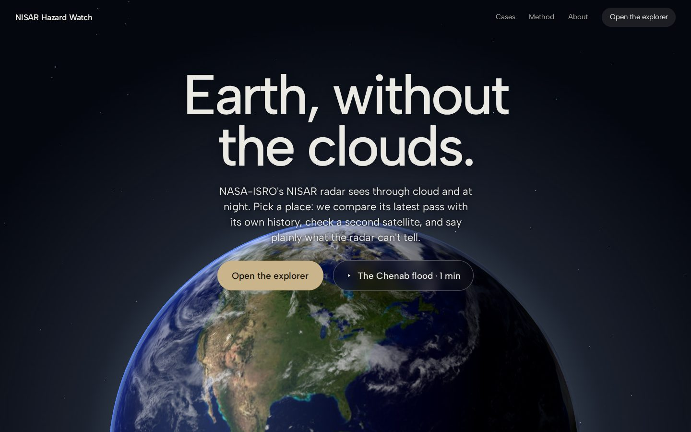
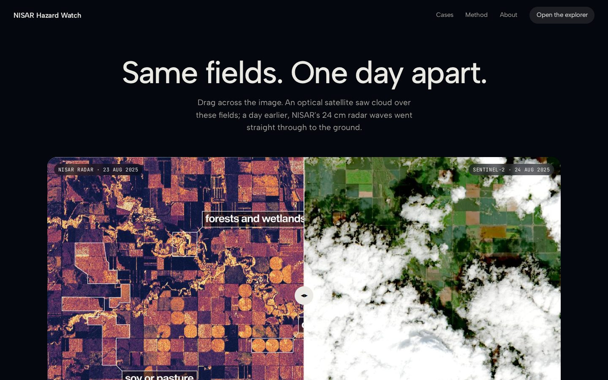
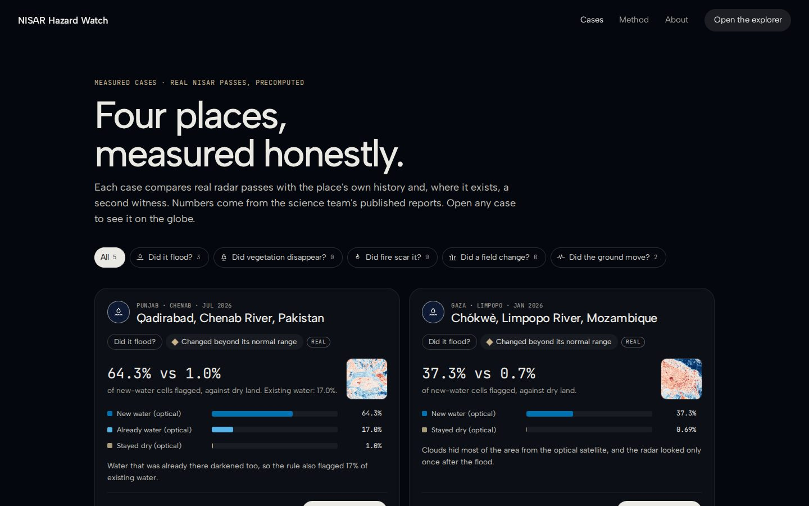
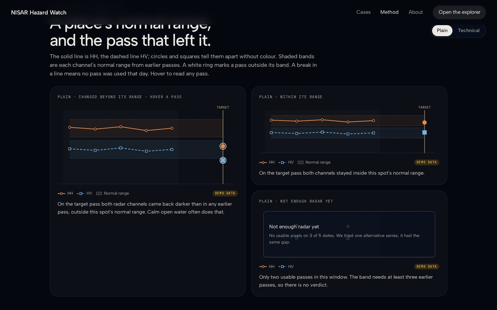
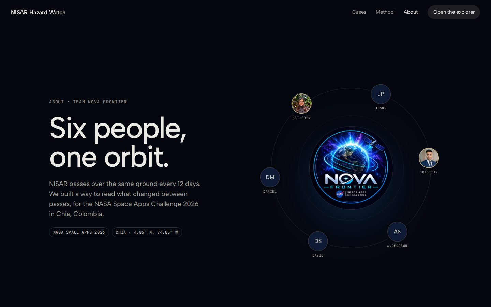
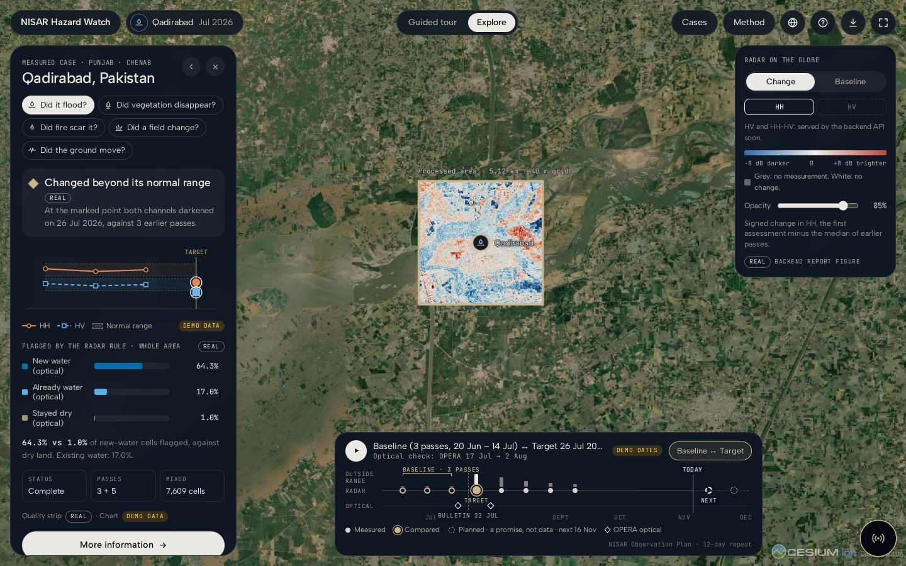
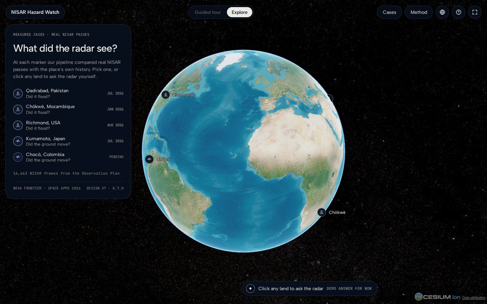
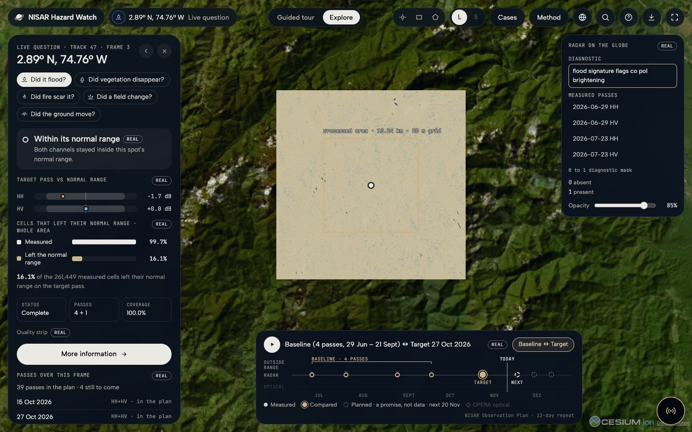
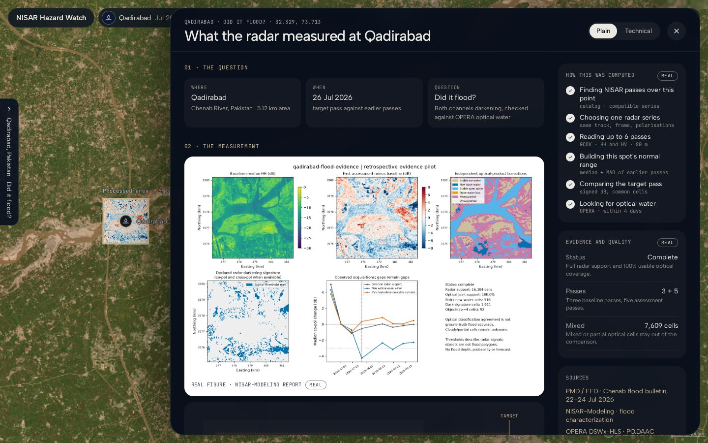

<div align="center">



# NISAR Hazard Watch

**Earth, without the clouds.**

NASA-ISRO's NISAR radar sees the ground through cloud and at night. NISAR Hazard Watch is a
**radar evidence explorer**: pick a place and it shows whether the radar echo there changed beyond
that place's own normal range, checks it against a second satellite, and says plainly what the
radar can't tell. No forecasts, no probabilities, no causes.

[](https://nisar-hazard-watch.vercel.app)
[](https://nisar-hazard-watch.vercel.app/method)

[](https://github.com/nisar-hazard-watch/nisar-hazard-watch/actions/workflows/ci.yml)


**[Live demo](https://nisar-hazard-watch.vercel.app)** ·
**[Cases](https://nisar-hazard-watch.vercel.app/cases)** ·
**[Method](https://nisar-hazard-watch.vercel.app/method)** ·
**[Science backend](https://github.com/Ch0comilo/NISAR-Modeling)**

</div>

> [!IMPORTANT]
> **Prototype status (design v7).** The NISAR frames, the satellite passes and every number in the
> measured cases are **real**: frames and passes come from NASA's NISAR Observation Plan, case
> numbers and layer images from the science team's reports
> ([Ch0comilo/NISAR-Modeling](https://github.com/Ch0comilo/NISAR-Modeling)). Some things are still
> **demo**: the per-pass band chart series, the pass timeline dates, and the answer to a live
> question on any other land. Every value carries a **Real** / **Demo** / **To fill** chip in the
> app; Demo and To fill chips can't be hidden. See
> [What is real and what is demo](#what-is-real-and-what-is-demo).

## Contents

- [Pages](#pages)
- [The explorer](#the-explorer)
- [Measured cases](#measured-cases)
- [Data sources and where they are fetched](#data-sources-and-where-they-are-fetched)
- [What is real and what is demo](#what-is-real-and-what-is-demo)
- [In progress](#in-progress)
- [Getting started](#getting-started)
- [Configuration](#configuration)
- [Testing](#testing)
- [Deploying](#deploying)
- [Project structure](#project-structure)
- [Contributing](#contributing)
- [Credits](#credits)

## Pages

| Path       | Page                                                                                                                                                         |
| ---------- | ------------------------------------------------------------------------------------------------------------------------------------------------------------ |
| `/`        | Landing: one scroll story over a three.js Earth, a drag-to-compare radar vs. optical view, the pipeline, the cases carousel, where the method fails, sources |
| `/explore` | The explorer: a CesiumJS globe with the measured cases and every NISAR frame                                                                                 |
| `/cases`   | The measured cases as cards, filterable by question                                                                                                          |
| `/method`  | How it works: satellite teardown, the Qadirabad sequence, six steps, the band chart, the five lenses, experimental models, landslides, colour key            |
| `/about`   | The team (Nova Frontier) and project links                                                                                                                   |

Shareable explorer links: `/explore?case=qadirabad` opens a measured case;
`/explore?frame=47-3` (optionally `&lens=<id>`) asks a live question on a NISAR frame. Old
`/?frame=` links still open the explorer.

<table>
  <tr>
    <td width="50%"></td>
    <td width="50%"></td>
  </tr>
  <tr>
    <td align="center"><b>Same fields, one day apart</b><br><sub>NISAR radar vs. Sentinel-2 over North Dakota</sub></td>
    <td align="center"><b>Cases</b><br><sub>Four measured places and one pending event</sub></td>
  </tr>
  <tr>
    <td width="50%"></td>
    <td width="50%"></td>
  </tr>
  <tr>
    <td align="center"><b>Method</b><br><sub>Reading the band chart (demo series)</sub></td>
    <td align="center"><b>About</b><br><sub>Team Nova Frontier</sub></td>
  </tr>
</table>

## The explorer



<p align="center"><b>A measured case:</b> Qadirabad, Pakistan. The verdict, the real contrast bars and the report's change crop on the globe; the band chart and timeline dates are labelled demo.</p>

- **Start card:** the measured cases and the frames snapshot status; case markers on the globe.
- **Case panel:** the question as lens chips ("Did it flood?", "Did the ground move?", …), the
  verdict in plain words, the band chart, the contrast bars against the optical witness, a quality
  strip and "More information".
- **More information:** a large sheet with the five beats in full (question, measurement, verdict,
  second witness, limits), the report figure, a drag-to-split compare tile, Plain / Technical
  modes and sources.
- **Layer dock:** the report's change or baseline crop draped on the globe, with an opacity slider.
- **Pass timeline:** baseline, target, measured and planned passes, the optical lane and the next
  planned pass.
- **Live question:** hover any land to see its NISAR frame, click to ask about it. The frame's
  passes are fetched live from the Observation Plan; the answer is a labelled demo until the
  backend API exists.
- **Help menu:** pages, "Show REAL labels" (hides only Real chips), reduce motion.

<table>
  <tr>
    <td width="50%"></td>
    <td width="50%"></td>
  </tr>
  <tr>
    <td align="center"><b>What did the radar see?</b><br><sub>The start card and case markers</sub></td>
    <td align="center"><b>A live question</b><br><sub>Real passes, demo answer</sub></td>
  </tr>
</table>



<p align="center"><b>More information:</b> the real NISAR-Modeling report figure, how it was computed, evidence and quality, sources.</p>

## Measured cases

All numbers live in `src/features/cases/cases.ts`, copied from the
[NISAR-Modeling](https://github.com/Ch0comilo/NISAR-Modeling) reports.

| Case                        | Question             | Verdict                         | Headline                                            |
| --------------------------- | -------------------- | ------------------------------- | --------------------------------------------------- |
| Qadirabad, Chenab, Pakistan | Did it flood?        | Changed beyond its normal range | 64.3% vs 1.0% of new-water vs dry cells flagged     |
| Chókwè, Limpopo, Mozambique | Did it flood?        | Changed beyond its normal range | 37.3% vs 0.7%, one assessment pass only             |
| Richmond, Indiana, USA      | Did it flood?        | Not enough radar yet            | 0 new-water cells resolved by the optical snapshots |
| Kumamoto, Kyushu, Japan     | Did the ground move? | Not enough radar yet            | 3 of 1,614 coherent cells eligible for corrections  |
| Chocó, Colombia             | Did the ground move? | Pending (event context only)    | No measurement until InSAR corrections pass         |

## Data sources and where they are fetched

| Data                                     | Source                                                                                                                                                                                                                                | How the app gets it                                                                                                                                                                                                                         |
| ---------------------------------------- | ------------------------------------------------------------------------------------------------------------------------------------------------------------------------------------------------------------------------------------- | ------------------------------------------------------------------------------------------------------------------------------------------------------------------------------------------------------------------------------------------- |
| NISAR frames (16,663 outlines)           | NASA NISAR Observation Plan, ArcGIS FeatureServer ([`nisar_merged_observation_plans/FeatureServer/0`](https://services7.arcgis.com/WSiUmUhlFx4CtMBB/arcgis/rest/services/nisar_merged_observation_plans/FeatureServer/0)), no API key | Snapshot in `public/data/frames.json` (fetched 2026-10-22), made by `pnpm frames:fetch` (`scripts/fetch-frames.ts`). The browser loads `/data/frames.json` and hit-tests frames locally, so hovering is instant and survives an API outage. |
| Passes per frame (past and planned)      | Same FeatureServer, one query per track/frame                                                                                                                                                                                         | Fetched live in the browser when a live question runs (`fetchAcquisitions` in `src/features/frames/observationPlanApi.ts`).                                                                                                                 |
| Basemap                                  | Esri World Imagery (`server.arcgisonline.com`), no key                                                                                                                                                                                | Cesium imagery tiles (`src/features/globe/cesium.ts`); no Cesium ion token.                                                                                                                                                                 |
| Case numbers, verdicts, quality, sources | [Ch0comilo/NISAR-Modeling](https://github.com/Ch0comilo/NISAR-Modeling) reports (`flood_pilot_summary.json`, `FLOOD_CHARACTERIZATION.md`, `TEAM_HANDOFF.md`, …)                                                                       | Copied into `src/features/cases/cases.ts`; each value's source is in its chip tooltip.                                                                                                                                                      |
| Case layer crops and report figures      | NISAR-Modeling report figures                                                                                                                                                                                                         | Static files in `public/cases/` (crops) and `public/cases/figures/`.                                                                                                                                                                        |
| Experimental model metrics (Method)      | [Ch0comilo/NISAR-Models](https://github.com/Ch0comilo/NISAR-Models) model cards                                                                                                                                                       | Copied into `src/features/charts/metrics.ts` and `src/pages/method/methodContent.ts`.                                                                                                                                                       |
| Landing and footer pictures              | NASA/JPL-Caltech, NASA Visible Earth, NASA HLS via Worldview, Wikimedia Commons                                                                                                                                                       | Static files in `public/landing/` and `public/footer/`, credited on the pages.                                                                                                                                                              |

There is no backend call yet: the science team's point exploration API is specified in
[EXPLORE_API.md](https://github.com/Ch0comilo/NISAR-Modeling/blob/main/docs/EXPLORE_API.md) and
not connected.

## What is real and what is demo

The full element-by-element list is the design handoff's `DATA_PROVENANCE.md`. In short:

| Real                                                                             | Demo (chip always visible)                                                      |
| -------------------------------------------------------------------------------- | ------------------------------------------------------------------------------- |
| NISAR frame outlines, track, frame, direction, HH+HV flag                        | Band chart series (HH/HV per pass) and its band, on cases and live questions    |
| Pass dates for a live question's frame (Observation Plan)                        | Pass timeline dates (12-day spacing) and its "% outside range" bars             |
| Case verdicts, contrast bars (cell counts), matched-pairs whisker, quality strip | The answer to a live question: verdict, quality, and the processing step timing |
| Change and baseline crops draped on the globe, report figures in the sheet       |                                                                                 |
| Method: works / fails cards, Transformer benchmark, experimental model metrics   |                                                                                 |

**To fill:** Chocó's event facts (Servicio Geológico Colombiano) and its NISAR frame. HV and
HH−HV layers are not drawn at all until the backend serves them.

## In progress

On another branch, not in `main` yet: the guided story on the Qadirabad (Chenab) flood
(`/explore?story=1`), a 4-step onboarding, Nova (a rule-based assistant, demo), and downloads
(PNG, JSON/CSV, a printable report page). Until then the explorer's "Guided tour" switch is
disabled ("Coming next") and the landing's "The Chenab flood" button opens the explorer.

Open questions for the science team are in issue
[#2](https://github.com/nisar-hazard-watch/nisar-hazard-watch/issues/2).

## Getting started

Requirements: Node.js 20.19+ and pnpm 8.

```bash
pnpm install
pnpm dev            # http://localhost:5173
```

| Command                              | What it does                                                |
| ------------------------------------ | ----------------------------------------------------------- |
| `pnpm dev`                           | Dev server on port 5173                                     |
| `pnpm build` / `pnpm preview`        | Production build (`tsc -b && vite build`) and local preview |
| `pnpm typecheck`                     | TypeScript, strict                                          |
| `pnpm lint`                          | oxlint                                                      |
| `pnpm format` / `pnpm format:check`  | Prettier, write or check                                    |
| `pnpm test`                          | Unit tests (Vitest)                                         |
| `pnpm test:e2e` / `pnpm test:e2e:ui` | End-to-end tests (Playwright), headless or in UI mode       |
| `pnpm frames:fetch`                  | Refresh `public/data/frames.json` from the Observation Plan |

## Configuration

**None.** The frontend reads no environment variables: the Observation Plan and Esri imagery need
no key. Old variables such as `VITE_ENABLED_HAZARDS` or `VITE_ANALYSIS_API_URL` are unused and can
be removed from any deployment.

> [!WARNING]
> Anything named `VITE_*` is baked into the JavaScript bundle and readable by every visitor. Never
> put a secret there (an LLM API key, a token, a password). Secrets belong in a backend that the
> browser calls.

## Testing

- **Unit (Vitest):** `tests/unit/`, for pure logic: Observation Plan parsing, frame hit-testing,
  the next planned pass, timeline layout, case data rules, live-question helpers, model metrics.
- **End-to-end (Playwright):** one spec per page in `tests/e2e/` (`site`, `cases`, `method`,
  `explorer`), page objects in `tests/e2e/pom/`, `data-testid` locators, the Observation Plan
  mocked from `tests/e2e/mocks/`.
- E2E runs against the **production build** (`pnpm build && pnpm preview`) on port 5174, or on
  `E2E_PORT` when set, with reduced motion on. Headless Chromium renders Cesium with software WebGL
  (SwiftShader), so it is slow; it uses two workers.
- **CI** (GitHub Actions): lint, format check, typecheck, unit tests and build, then E2E, on every
  push to `main` and every pull request.

## Deploying

The app is a static single-page build: `pnpm build` writes `dist/`. It is hosted on Vercel;
`vercel.json` rewrites every path except `data/`, `cesium/` and `assets/` to `index.html`. Any
static host works with the same fallback. No environment variables are needed.

## Project structure

```text
src/
├── App.tsx            Page switch on the pathname (no router dependency)
├── pages/             landing, explorer, cases, method, about, and site/ (shared nav, footer, tokens)
├── content/           Team, data sources, the landing's Barh example
├── features/
│   ├── cases/         Measured cases, lenses, demo band series, hazard icons
│   ├── case-panel/    Case and live-question panel: verdict, quality strip, chips
│   ├── charts/        Band chart (Recharts), contrast bars, matched whisker, metrics chart
│   ├── frames/        Frames snapshot, hit-testing, Observation Plan client, next planned pass
│   ├── globe/         CesiumJS viewer, case markers, frame outlines, camera framing
│   ├── live/          Live question: job steps, demo answer, the frame's planned passes
│   ├── sheet/         "More information" sheet and compare tile
│   └── timeline/      Pass timeline and its layout maths
└── lib/               Navigation, async state, provenance chip, shared helpers
public/                frames.json, case crops and figures, landing, footer and team pictures
scripts/               Frames snapshot generator
tests/                 Unit (Vitest) and E2E (Playwright, page objects, mocks)
docs/screenshots/      README pictures
```

## Contributing

- **Conventional commits** (`feat:`, `fix:`, `docs:`, …), enforced by commitlint. Husky and
  lint-staged run oxlint and Prettier before each commit.
- **TypeScript strict** with `noUncheckedIndexedAccess` and `exactOptionalPropertyTypes`; named
  exports; `@/` imports; comments say _why_, not _what_.
- Every async view handles loading, error (with retry) and empty states.
- Project conventions for people and AI agents: [`CLAUDE.md`](CLAUDE.md). Visual system:
  [`DESIGN.md`](DESIGN.md).

## Credits

- **NASA-ISRO NISAR** L2 GCOV and GUNW products, via the
  [Alaska Satellite Facility DAAC](https://search.asf.alaska.edu/).
- **NASA NISAR Observation Plan** (frames and passes).
- **NASA JPL OPERA** DSWx-HLS and DIST-ALERT (the optical second witness in the science reports).
- Science backend and models: [NISAR-Modeling](https://github.com/Ch0comilo/NISAR-Modeling) and
  [NISAR-Models](https://github.com/Ch0comilo/NISAR-Models).
- Landing pictures: NISAR's first image of North Dakota and the artist's concept of NISAR
  (NASA/JPL-Caltech); Blue Marble and cloud imagery (NASA Visible Earth), all public domain.
  Optical view: NASA HLS, contains modified Copernicus Sentinel-2 data (2025), via NASA Worldview.
- Base imagery © Esri, Maxar, Earthstar Geographics. Globe by
  [CesiumJS](https://cesium.com/platform/cesiumjs/).
- Pass timeline's next-planned-pass idea: Katheryn Guasca
  ([#1](https://github.com/nisar-hazard-watch/nisar-hazard-watch/pull/1)).

Built by team **Nova Frontier** for the **NASA International Space Apps Challenge 2026**.
